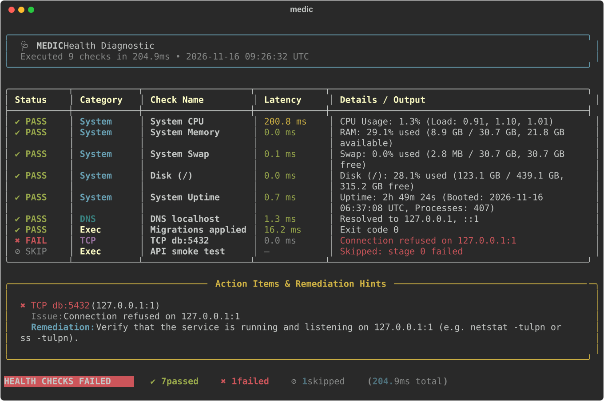

# 🩺 medic

[](https://github.com/Rogsiel/medic/actions/workflows/ci.yml)
[](https://pypi.org/project/medic-cli/)
[](LICENSE)

A small health-check CLI. Use it as a **checkpoint in a pipeline** (exit code + JUnit), as a
**one-off diagnostic**, or as a **live terminal monitor** (`--watch`). No server, no daemon.

medic reports problems; it does not fix them.



## Checks

| Type | What it verifies |
|---|---|
| `system` | CPU, load, memory, swap, disk per mount, uptime |
| `ping` | ICMP reachability, packet loss, RTT (uses the system `ping`) |
| `tcp` | Port reachability, connect latency, optional banner |
| `http` | Status code, latency, body substring, TLS verification |
| `tls` | Certificate expiry (days left), issuer, SANs, protocol |
| `ssh` | Daemon reachability, protocol/banner, optional key auth |
| `dns` | Name resolution, optional expected addresses |
| `exec` | Run a command; pass on expected exit code / output |

## Install

```bash
pipx install medic-cli          # or: pip install medic-cli
# latest from git
pipx install git+https://github.com/Rogsiel/medic.git
```

Requires Python 3.10+. Enable shell completion (bash, zsh, fish) with:

```bash
medic --install-completion
```

## Quick start

```bash
medic                                   # local system checks only (no network)
medic --all                             # + internet reachability (ping, HTTP, TLS)
medic --tcp db:5432 --http https://api.example.com/health --http-match ok
medic --tls example.com --tls-warn-days 30 --tls-crit-days 7
medic --dns example.com --exec "pg_isready -h db"
medic --system --disk / --disk /var --cpu-threshold 70,90 --ram-threshold 80,95
```

Run `medic --help` for every flag.

## Pipelines and CI

Exit codes: `0` healthy, `1` a check failed (or warned, with `--fail-on warning`), `2` bad config.

Declare checks in TOML. Checks with a higher `stage` are **skipped if any lower stage fails**, which
gives you checkpoint semantics:

```toml
# medic.toml
[settings]
timeout = 6
fail_on = "failure"        # or "warning"

[[check]]
type = "tcp"
target = "db:5432"
stage = 0

[[check]]
type = "http"
name = "API"
url = "https://api.example.com/health"
expect_status = [200]
match = "ok"
stage = 1
```

```bash
medic --config medic.toml --format junit > medic.xml
```

Check keys by type:

| Type | Keys |
|---|---|
| `system` | `disks`, `cpu`, `ram`, `disk_threshold` (each `[warn, crit]`) |
| `ping` | `host`, `count` |
| `tcp` | `target` (`host:port`) or `host` + `port` |
| `http` | `url`, `method`, `expect_status`, `match`, `verify_ssl`, `headers` |
| `tls` | `target` or `host` + `port`, `warn_days`, `crit_days` |
| `ssh` | `target`, `user`, `key`, `auth` |
| `dns` | `host`, `expect` |
| `exec` | `command`, `expect_exit`, `match`, `shell`, `cwd` |

All checks also accept `name`, `stage`, `timeout`, `enabled`. Explicit CLI flags override `[settings]`.
Unknown types or keys are rejected.

Every check is bounded by its timeout (+2s grace). A hung check is reported as failed instead of
blocking the run. `--stop-on-failure` runs sequentially and stops at the first failure.

GitHub Actions example:

```yaml
- run: pipx install git+https://github.com/Rogsiel/medic.git
- run: medic --config medic.toml --format junit > medic.xml
```

## Watch mode

```bash
medic --config medic.toml --watch 5
```

Re-runs every 5 seconds and redraws the report. Status transitions (e.g. `passed -> failed`) are
logged to stderr as `[change] ...`. Ctrl-C exits with the last run's exit code.

## Output formats

`--format rich` (default), `text`, `compact`, `json`, `junit`.

## Development

```bash
pip install -e '.[dev]'
pytest
ruff check .
mypy medic
```

## License

MIT
